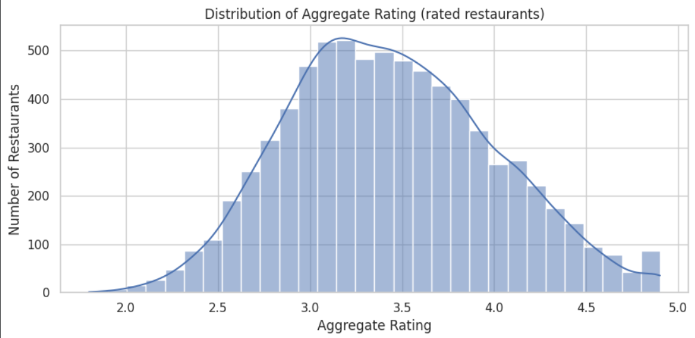
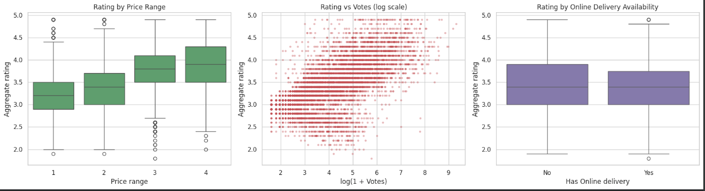
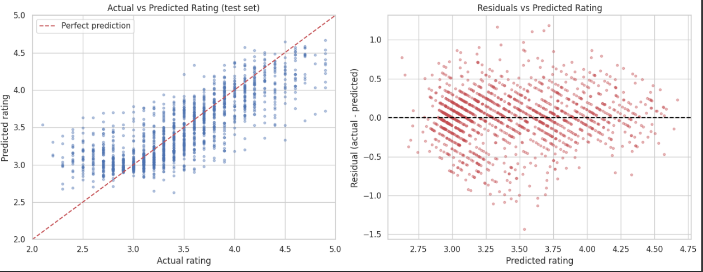
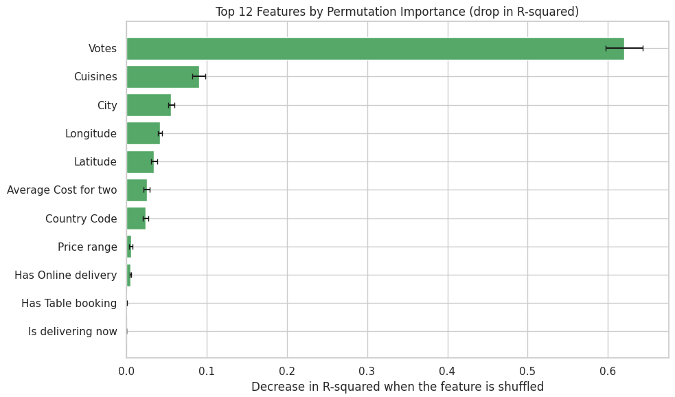

# Restaurant Rating Prediction

## Cognifyz Technologies — Machine Learning Task 1

A supervised machine learning project that predicts restaurant aggregate ratings using restaurant attributes from the provided dataset. The workflow covers data preparation, feature engineering, cross-validation, model comparison, hyperparameter tuning, and final evaluation on a held-out test set.

## Project Objective

Build and evaluate regression models that estimate a restaurant's **Aggregate Rating** from available restaurant information, and identify which features contribute most to the predictions.

## Dataset

The dataset contains **9,551 restaurant records** and 21 columns.

- **7,403 records** with positive ratings were used to train and evaluate the models.
- **2,148 records** with an aggregate rating of `0` were treated as unrated records and excluded from the rating-prediction target.
- Nine records have missing cuisine information; the notebook handles missing data during preprocessing.

The analysis uses restaurant attributes such as cuisine, city, location coordinates, votes, price range, average cost for two, and booking/delivery options. The dataset itself is not included in this repository; add the authorized dataset locally or upload it to your notebook environment before running the analysis.

## Workflow

1. Load and inspect the dataset.
2. Check data quality, missing values, and rating distribution.
3. Separate unrated records from records with usable rating targets.
4. Engineer restaurant features within a scikit-learn pipeline to help prevent cross-validation data leakage.
5. Exclude `Rating color` and `Rating text` because they are derived from the aggregate rating and would leak target information.
6. Compare a mean-prediction baseline with Linear Regression, Decision Tree, Random Forest, and Gradient Boosting models.
7. Use five-fold cross-validation to compare models and tune the selected model with `GridSearchCV`.
8. Evaluate the selected model on a held-out test set using R², RMSE, and MAE.
9. Inspect feature importance and prediction errors, and assess how excluding unrated records affects the scope of the conclusions.

## Results

The reported run selected a tuned **Random Forest Regressor** based on cross-validation.

| Metric | Result |
|---|---:|
| Test R² | 0.661 |
| Test RMSE | 0.324 |
| Test MAE | 0.238 |
| Baseline RMSE | 0.556 |

The untuned model-comparison table reported these test R² scores:

| Model | Test R² |
|---|---:|
| Random Forest | 0.655 |
| Gradient Boosting | 0.638 |
| Linear Regression | 0.609 |
| Decision Tree | 0.587 |
| Mean baseline | -0.000 |

The tuned Random Forest's reported R² is **0.661**; the **0.655** score above is from the separate untuned Random Forest comparison. The notebook's feature-importance analysis identified **Votes, Cuisines, City, Longitude, and Latitude** among the leading predictive features.

These results describe performance on the held-out test split of this dataset. They do not guarantee the same accuracy on new datasets or in a live restaurant-rating system.

## Visual Results

### Rating Distribution


The ratings for restaurants included in the supervised modelling dataset are concentrated mostly around the low-to-mid 3s.

### Exploratory Analysis


These plots compare ratings across price ranges, against vote counts on a log scale, and by online-delivery availability.

### Model Diagnostics


The actual-versus-predicted plot compares test-set predictions with the perfect-prediction line. The residual plot helps inspect prediction errors across the predicted-rating range.

### Permutation Feature Importance


Votes has the largest permutation importance in this run, followed by cuisines, city, longitude, and latitude. Importance reflects predictive usefulness in this dataset, not causal influence.

## Repository Contents

- `Task_1_Cognifyz_Restaurant_Rating_Prediction_CV_Safe.ipynb` — notebook containing the analysis, model training, evaluation, and visualizations.
- `requirements.txt` — Python package dependencies.
- `README.md` — project overview, methodology, and reported results.
- `.gitignore` — common files and local artifacts excluded from version control.

## Requirements

Python 3.10 or a compatible Python environment, with the packages listed in `requirements.txt`. The notebook uses common data-science tools including pandas, NumPy, scikit-learn, and Matplotlib/Seaborn where specified by the notebook.

## How to Run

### Google Colab

1. Upload the notebook to Google Colab.
2. Upload the dataset when prompted by the notebook, or update the dataset path to match your file.
3. Run the notebook cells from top to bottom.
4. Review the cross-validation comparison, selected parameters, test metrics, and feature-importance outputs.

### Local Jupyter Environment

1. Clone or download this repository.
2. Install dependencies:

   ```bash
   pip install -r requirements.txt
   ```

3. Place the dataset in the expected location or update the notebook's dataset path.
4. Open the notebook and run all cells.

## Important Notes and Limitations

- Records with an aggregate rating of `0` are treated as unrated, not as genuine zero-star ratings, and are excluded from supervised rating prediction.
- `Rating text` and `Rating color` are excluded from the predictors because they are derived from the target.
- Feature engineering is placed inside the modeling pipeline so transformations that learn from data are fitted within each cross-validation training fold.
- `Votes` is a strong predictor in this dataset, but it may not be available at the time a new restaurant first needs a rating estimate. Its presence can also make the model less suitable for early-stage predictions.
- The analysis demonstrates predictive relationships, not causal effects. Results depend on the dataset, split, preprocessing, and model configuration.

## Technologies

- Python
- pandas and NumPy
- scikit-learn
- Matplotlib / Seaborn (for visual analysis, where used)
- Jupyter Notebook / Google Colab

## Author

**Pradeep Srinivas B**

## Acknowledgment

Prepared as part of the **Cognifyz Technologies** machine learning task on restaurant rating prediction.
